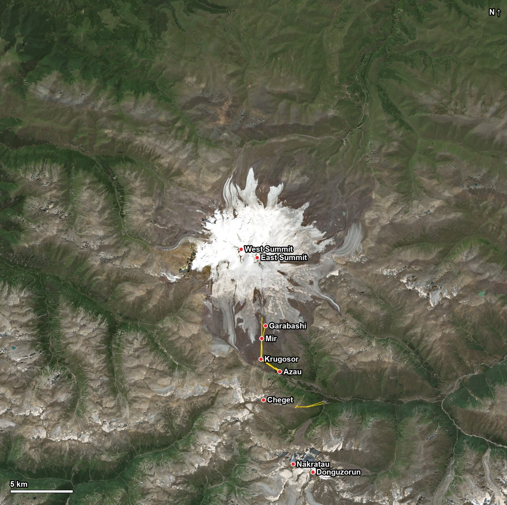

# Phase 1 results: data pipeline v1

Built on 2026-11-25 with `pipeline/run_all.sh`.

## Area
- 40.2 × 40.08 km, UTM 38N, bounds 273 240 – 313 440 E / 4 782 840 – 4 822 920 N
  (about lon 42.20–42.70, lat 43.16–43.54).

## Elevation (Copernicus GLO-30)
- Grid 1340 × 1336 at 30 m, no voids. Range **1,387 – 5,628 m**.
- Highest DEM pixel is **9.6 m** from the OSM position of the West Summit (5,642 m).
- Across 403 OSM summits with surveyed heights, the DEM is lower by a **median of 13 m**
  (p10 −61 m, p90 +3 m). That's expected: a 30 m grid flattens sharp peaks. Broad slopes and
  valleys are accurate. If we want summits to read exact heights, the viewer can show the
  surveyed value from POI data rather than the terrain height.

## Imagery (Sentinel-2 L2A)
- Acquisition **2025-08-24**, 100 % clear over the area, about 8 % snow/ice (glaciers only, no fresh snow).
- 4 tiles: 38TLN, 38TLP (native zone) + 37TGH, 37TGJ (reprojected, western fill).
- Mosaic 4020 × 4008 at 10 m, no gaps. Sun at capture: azimuth 157°, elevation 56°.
  The viewer's light should come roughly from there, so 3D shading agrees with the shadows
  already in the photo.
- 54 candidate dates (Aug–Sep 2023–2025) were available. Six of them are fully clear,
  so we can swap the look easily (for example 2025-09-23 has fresh snow: 40 %).

## OpenStreetMap
- 882 points: 451 summits, 213 saddles, 59 huts, 22 lift stations, 77 lodgings, 21 viewpoints, 39 villages.
- 90 lines: cable cars, chairlifts and mountain paths (with SAC scale).
- All the main south-route places are there with heights: Azau (2,350), Krugosor (3,000), Mir (3,500),
  Garabashi (3,780), Bochki (3,710), Priyut, both summits, Cheget.

## Visual check
- Hillshade: relief and cone look correct ([img/phase1-hillshade.jpg](img/phase1-hillshade.jpg)).
- Overlay: POIs and the Azau → Garabashi lift line fall exactly on the right features. Texture and terrain are aligned.

## Data size (local, git-ignored)
- `data/raw` 40 MB, `data/work` 113 MB. Nothing is web-optimised yet (that's phase 3).

## Notes for next phases
- Snow on the summit cap is close to clipping with the current tone curve. Tune it during polish (`--tone-only`).
- Curating `content/pois.geojson` from the 882 seed points is a content task (phase 5).
  Phase 2 can use a hard-coded shortlist.
